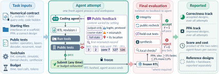
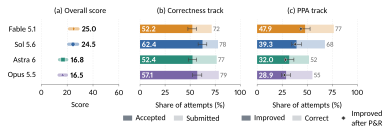

# AIChipBench: Benchmarking LLM Agents for Automated AI Accelerator Design

[](https://arxiv.org/abs/2611.33093)
[](https://frontiereval.github.io/AIChipBench/)

### Decoder hardware that must stay exact, in outputs and stored state, at every decoding step

AIChipBench asks LLM coding agents to implement quantized Qwen3.5, Gemma 3, Gemma 4, and Llama 3.2 decoders in synthesizable register-transfer-level (RTL) code. An executable integer reference specifies the outputs and the stored state at every decoding step. Agents debug against public tests under fixed budgets, and their frozen designs are graded on held-out token sequences, resets, memory stalls, and synthesis. A second track asks agents to speed up a correct design at nearly fixed area without breaking it.

**Authors:** Guangyuan Wang (Mila, McGill University), Chengran Li, Minchen Luo (Erised Labs), Jichen Feng (Princeton University, University of Pennsylvania), Mengdi Wang (Princeton University), [Yifan Zhang](https://yifzhang.com) (Princeton University)

[[Project website](https://frontiereval.github.io/AIChipBench/)] [[Leaderboard](#leaderboard)] [[Findings](#findings)]



## Two tracks, one evaluator

An agent is a language model run in a tool-using harness: it inspects files, writes and revises hardware code, runs lint, simulation, and synthesis, reads test feedback, and submits a design within caps on wall time, tool calls, and output tokens.

- **Correctness track.** The agent starts from module interfaces or a working accelerator scaffold and implements a quantized decoder in RTL. Twelve tasks cover seven targets from the Qwen3.5, Gemma, and Llama 3.2 families.
- **PPA track.** The agent starts from a correct reference design and must raise throughput by at least 5% with at most 2% more LUTs while every check still passes. Four targets, on an AMD Alveo U250 FPGA at a 126 MHz target clock.
- **Frozen, held-out grading.** An integer oracle gives the exact outputs and stored state at every transaction. A submitted design is frozen and accepted only if it matches the oracle on held-out sequences, resets, and memory stalls, synthesizes, and leaves protected files intact.

## Leaderboard

Four coding agents make 9,136 attempts: 472 each on the correctness track and 384 each on the PPA track, and the rest in diagnostic studies. The overall score multiplies the two track scores.

| Agent | Overall score (95% interval) | Correctness track (c̄) | PPA track (q̄) |
| --- | ---: | ---: | ---: |
| Fable 5.1 | **25.0** (21.8–28.4) | 52.2 | 47.9 |
| Sol 5.6 | **24.5** (21.2–28.1) | 62.4 | 39.3 |
| Astra 6 | **16.8** (14.1–19.7) | 52.4 | 32.0 |
| Opus 5.5 | **16.5** (13.7–19.4) | 57.1 | 28.9 |

Score = 100 · c̄ · q̄, with a paired bootstrap 95% interval. c̄ is the acceptance rate averaged over the twelve correctness tasks, and q̄ the rate of improved designs averaged over the four PPA targets. All values are percentages.



## Findings

- **Agents adapt a scaffold more reliably than they build a full-size decoder from interfaces.** On four full-size targets, 408 of 704 attempts from a scaffold are accepted, against 239 from interfaces.
- **Agents do much better when told where state diverges.** Feedback that locates the first state mismatch raises acceptance over output-only feedback in all 12 agent–task cells, by 25.0 to 46.9 points, and lowers the cost per accepted design from 13.4 to 6.5 agent-hours.
- **Passing a test suite does not establish exactness.** 148 designs pass every public test and fail final acceptance. When frozen submissions are regraded, 45 of 69 accepted designs fail a new sequence or condition within the 32 steps their tests required.
- **Longer horizons lower acceptance, and the budget binds.** At the 1× budget, pooled acceptance falls from 252 to 115 of 288 attempts between one and 16 required decoding steps, and 489 of 1,888 correctness-track attempts end at a cap without submitting.
- **Optimization often ends without a correct design.** 571 of 1,536 PPA attempts end without a correct design, although each started from one that passed every gate.

## Resources

- [Project website](https://frontiereval.github.io/AIChipBench/)
- [Paper (arXiv:2611.33093)](https://arxiv.org/abs/2611.33093)

## Citation

```bibtex
@misc{wang2026aichipbench,
  title  = {AIChipBench: Benchmarking LLM Agents for Automated AI Accelerator Design},
  author = {Wang, Guangyuan and Li, Chengran and Luo, Minchen and Feng, Jichen and Wang, Mengdi and Zhang, Yifan},
  year   = {2026},
  eprint = {2611.33093},
  archivePrefix = {arXiv},
  primaryClass  = {cs.CL}
}
```
